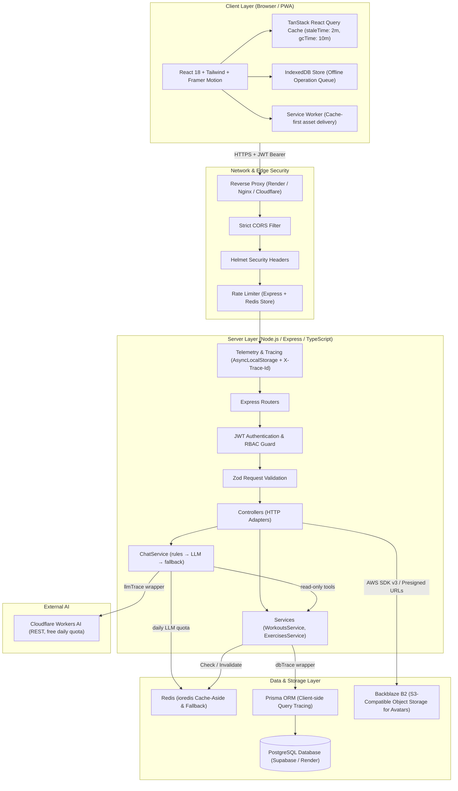
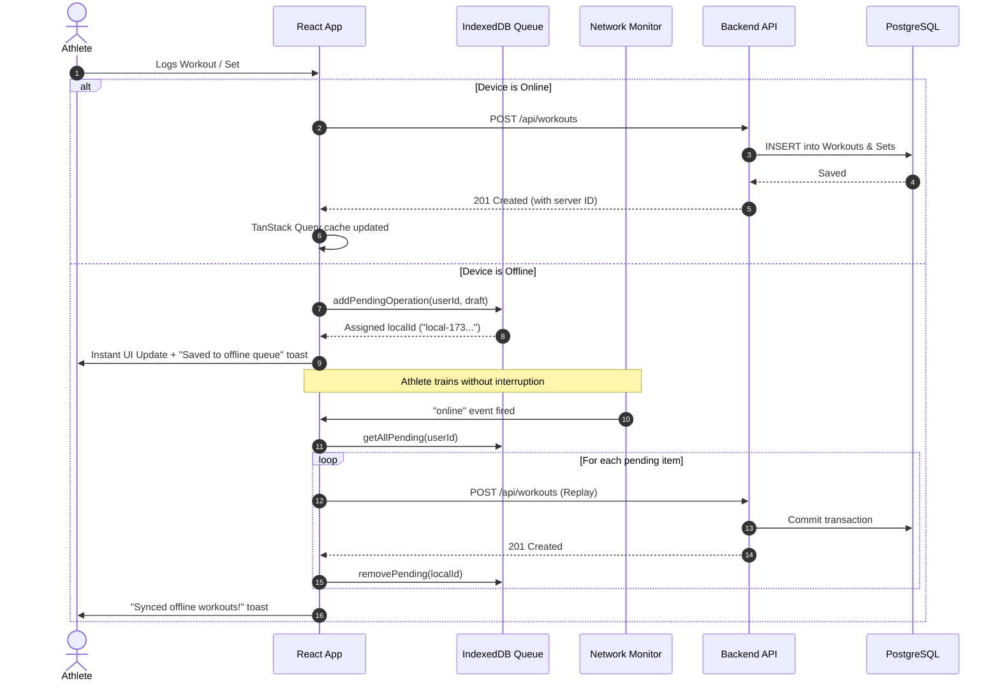
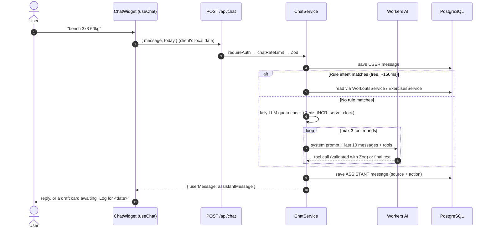

# GymTrack System Architecture & Engineering Handbook

> **Project Mission**: A production-grade, offline-capable fitness tracking platform and learning playground built with modern TypeScript, React, Node.js, PostgreSQL, and Redis.

---

## 1. System Overview & Mental Model

GymTrack is architected as an **offline-first, distributed full-stack application**. It balances rapid client responsiveness (via PWA service workers and React Query client caches) with high-throughput backend efficiency (via Redis cache-aside, resilient fallbacks, and indexed PostgreSQL relational queries).



---

## 2. Core Architectural Pillars

### 2.1 Separation of Concerns & Clean Layering

A scalable enterprise system enforces strict boundaries between layers:

```
Request ──> [Routes] ──> [Middleware] ──> [Controllers] ──> [Services] ──> [Data Access / Prisma / Redis]
```

1. **Routes (`src/routes/`)**:
   - Sole responsibility: Map URI paths and HTTP verbs to middlewares and controllers.
   - Example: [`workouts.routes.ts`](file:///d:/gymtrack/server/src/routes/workouts.routes.ts).
2. **Middleware (`src/middleware/`)**:
   - Cross-cutting concerns: Authentication ([`auth.ts`](file:///d:/gymtrack/server/src/middleware/auth.ts)), schema validation ([`validate.ts`](file:///d:/gymtrack/server/src/middleware/validate.ts)), telemetry ([`tracker.ts`](file:///d:/gymtrack/server/src/middleware/tracker.ts)), security headers ([`helmet`](https://helmetjs.github.io/)).
3. **Controllers (`src/controllers/`)**:
   - HTTP transport layer: Pure adapters that extract request inputs (`params`, `body`, `query`), invoke domain services, and translate service outputs into standard HTTP status codes and JSON envelopes.
4. **Services (`src/services/`)**:
   - Pure business logic & orchestration layer: Independent of Express `req`/`res`. Manages data transactions, ownership checks, caching strategies, and data transformations.
   - Example: [`workouts.service.ts`](file:///d:/gymtrack/server/src/services/workouts.service.ts), [`exercises.service.ts`](file:///d:/gymtrack/server/src/services/exercises.service.ts).
5. **Data Access & Storage (`src/db/`, `src/lib/`)**:
   - Database client abstraction ([`prisma.ts`](file:///d:/gymtrack/server/src/db/prisma.ts)).
   - Distributed cache wrapper with graceful degradation ([`redis.ts`](file:///d:/gymtrack/server/src/lib/redis.ts)).
   - S3-compatible cloud object storage ([`storage.ts`](file:///d:/gymtrack/server/src/lib/storage.ts)).

---

### 2.2 Dual-Layer Caching Strategy

Caching is implemented symmetrically at both ends of the wire to maximize perceived speed while minimizing database load:

| Metric / Dimension | Frontend (TanStack Query) | Backend (Redis Cache-Aside) |
| :--- | :--- | :--- |
| **Storage Engine** | Browser Memory (JavaScript heap) | Redis In-Memory KV Store |
| **Cache Key Strategy** | Hierarchical array: `['workouts', { date }]` | Colon-delimited: `exercises:userId:muscle:equipment:page:limit` |
| **Freshness (TTL)** | `staleTime: 2 minutes`, `gcTime: 10 minutes` | `TTL: 1800 seconds (30 minutes)` |
| **Invalidation Hook** | `queryClient.invalidateQueries(...)` on mutations | `invalidateCachePattern('exercises:*')` on create/edit |
| **Resilience Mechanism** | Offline fallback to IndexedDB queue | Graceful fallback to direct PostgreSQL if Redis is down |

#### Backend Cache-Aside Pattern ([`redis.ts`](file:///d:/gymtrack/server/src/lib/redis.ts))
```typescript
export async function cacheAside<T>(key: string, ttlSeconds: number, fetcher: () => Promise<T>): Promise<T> {
  // 1. Check Redis if available
  if (redis && isRedisConnected()) {
    const cached = await redis.get(key);
    if (cached) return JSON.parse(cached) as T; // CACHE HIT
  }
  // 2. CACHE MISS -> Fetch from PostgreSQL
  const data = await fetcher();
  // 3. Asynchronously populate cache (non-blocking)
  if (redis && isRedisConnected() && data != null) {
    redis.setex(key, ttlSeconds, JSON.stringify(data)).catch(console.warn);
  }
  return data;
}
```

---

### 2.3 Offline-First Architecture & Sync Lifecycle

GymTrack operates reliably even in basement gym settings without Wi-Fi or cellular connectivity:



---

### 2.4 Observability, Tracing, and Telemetry

Instead of treating server operations as a black box, GymTrack embeds **distributed tracing**:

1. **`X-Trace-Id`**: Every incoming HTTP request is assigned a UUID. This ID flows through:
   - Request logger
   - Response headers (`exposedHeaders: ['X-Trace-Id']`)
   - AsyncLocalStorage context ([`asyncContext.ts`](file:///d:/gymtrack/server/src/lib/asyncContext.ts))
   - Database query logs ([`dbTrace.ts`](file:///d:/gymtrack/server/src/lib/dbTrace.ts))
2. **Database Query Tracing (`dbTrace`)**:
   - Wraps every Prisma invocation to measure exact execution time in milliseconds.
   - Attaches execution metrics to live admin telemetry logs.
3. **Live Admin Traffic Map**:
   - Captures client IP, geolocation, request status, duration, and associated DB query for security auditing and performance tuning.

---

### 2.5 Cloud Storage & Media Handling

User avatars use an **enterprise zero-disk architecture**:
- Uploaded file streams directly from client multipart form data into Node memory buffer via `multer.memoryStorage()`.
- Uploaded directly into Backblaze B2 (S3-compatible) using AWS SDK v3 `PutObjectCommand`.
- The database stores **only the storage key** (e.g., `avatars/user-uuid-1729.png`), never binary BLOBs.
- Read operations generate **time-limited presigned URLs** (`getSignedUrl` from `@aws-sdk/s3-request-presigner`) valid for 24 hours, ensuring private bucket security without proxying heavy media bytes through the Node server.

---

### 2.6 Chat Assistant (Rules First, LLM Fallback)

A floating assistant (`ChatWidget`) lets users log workouts and ask about their training in plain language. The design goal is **free, instant answers for common phrases**, with an LLM only for the long tail.



**Layers** (`server/src/services/chat/`):

| File | Responsibility |
| :--- | :--- |
| `intents.ts` | Pure regex parser: `LOG_WORKOUT`, `WORKOUTS_ON_DATE`, `PERSONAL_BEST`, `LAST_WORKOUT`, `GREETING`, `HELP`. Returns `null` to hand off to the LLM. |
| `exerciseMatch.ts` | Resolves "bench" / "rdl" / "pull ups" to library names. Ranking: exact match > the user's own history > library, shortest name breaks ties. |
| `tools.ts` | Read-only data access shared by rules and the LLM, with compact output to save tokens. |
| `proposal.ts` | The LLM's `propose_workout_log` tool and lenient parsing of its arguments. |
| `llmQuota.ts` | Per-user daily LLM cap (Redis `INCR`, in-memory fallback). |
| `chat.service.ts` | Orchestration, the tool-calling loop, persistence to `ChatMessage`. |
| `lib/llm.ts` | Provider-agnostic `LlmProvider` interface + `WorkersAiProvider`, timeouts, error mapping, `llmTrace`. |

**Guardrails** (each one was added in response to observed model behavior, and is covered by tests using captured payloads):

1. **The bot never writes workouts.** Logging returns a `CREATE_WORKOUT` draft. The client confirms it through `AppDataContext.createWorkout`, the same online/offline-queue path as the workout form.
2. **`userId` never comes from the model.** Tools take it from the authenticated request, so prompt injection cannot read another account's data.
3. **Model output is untrusted input.** Tool arguments are validated with Zod; unknown tools and bad arguments return an error object the model can read instead of throwing.
4. **Remove options instead of asking nicely.** `propose_workout_log` is only offered when the message looks like a workout report (has numbers, isn't a question). The small model otherwise "proposed" invented workouts in reply to questions.
5. **Bounded cost.** Max 3 tool rounds (the final round offers no tools), `max_tokens: 300`, 20 messages/minute per user, and a daily LLM cap keyed on the **server** clock (a client-supplied date could reset it).
6. **Graceful degradation.** No credentials, quota exhausted, timeout, or provider error all produce a `FALLBACK` reply; rule-based commands keep working.
7. **Transparency.** LLM replies are labeled in the UI; `ChatMessage.source` (`RULE` / `LLM` / `FALLBACK`) records which path answered, so frequent LLM questions can be promoted to rules.

**Client-side duplicate protection:** only the newest draft is actionable, a ref blocks double taps, and confirmed/dismissed draft IDs are remembered per device in `localStorage` (guarded with try/catch).

---

### 2.7 Responsive Shell & Local Dates

- The sidebar is a static column from the `md` breakpoint up and a slide-in drawer below it (opened from the header, closed on navigation, backdrop tap, or Escape). The chat panel is full screen on phones and a corner card on larger screens.
- **"Today" is always the device's local date** (`localToday()` in `client/src/utils/date.ts`), never `toISOString()`, which is UTC and would date early-morning workouts as the previous day in timezones ahead of UTC.

---

## 3. Database Schema Design (Prisma)

```
[User] 1 ────< [Workout] 1 ────< [WorkoutSet]
  │
  ├──────< [Template] 1 ───< [TemplateExercise]
  │
  ├──────< [Exercise] (Public or Custom)
  │
  └──────< [ChatMessage] (role, content, source, action JSON)
```

- **Referential Integrity**: Cascading deletes (`onDelete: Cascade`) guarantee that removing a workout automatically wipes its nested sets, and removing an account purges all associated workout logs and private routines.
- **Ownership Isolation**: Every query in [`workouts.controller.ts`](file:///d:/gymtrack/server/src/controllers/workouts.controller.ts) strictly filters by `userId: req.user.id`, preventing horizontal privilege escalation.
- **Performance Indexes**: Multi-column indexes on `Exercise(muscleGroup)` and `Exercise(userId)` accelerate filtered and user-custom searches. A composite `ChatMessage(userId, createdAt)` index serves "this user's latest N messages" (filter column first, sort column second).

---

## 4. Engineering Standards & Code Conventions

1. **Type Safety Across the Wire**:
   - Frontend and backend TypeScript definitions mirror each other.
   - Runtime inputs are validated using Zod before reaching any business logic.
2. **Validated Configuration**:
   - [`config/env.ts`](file:///d:/gymtrack/server/src/config/env.ts) parses `process.env` with a Zod schema once at startup (defaults for local dev, typed exports).
   - Production refuses to boot with the public development `JWT_SECRET`; optional integrations (B2, Workers AI) degrade gracefully when unset.
3. **Defensive Async Handling**:
   - Unhandled rejections are caught by the centralized Express [`errorHandler.ts`](file:///d:/gymtrack/server/src/middleware/errorHandler.ts).
   - Redis operations are non-blocking; a Redis downtime never crashes an HTTP route.
4. **Security Standards**:
   - Passwords hashed with Bcrypt (salt rounds: 10+).
   - Strict CORS origin whitelisting.
   - Helmet for HTTP header protection.
   - Rate limiting per IP to mitigate brute force attempts (per account for chat, so shared gym Wi-Fi doesn't collide).
   - LLM output is treated as untrusted input: validated before use and never trusted for identity.

